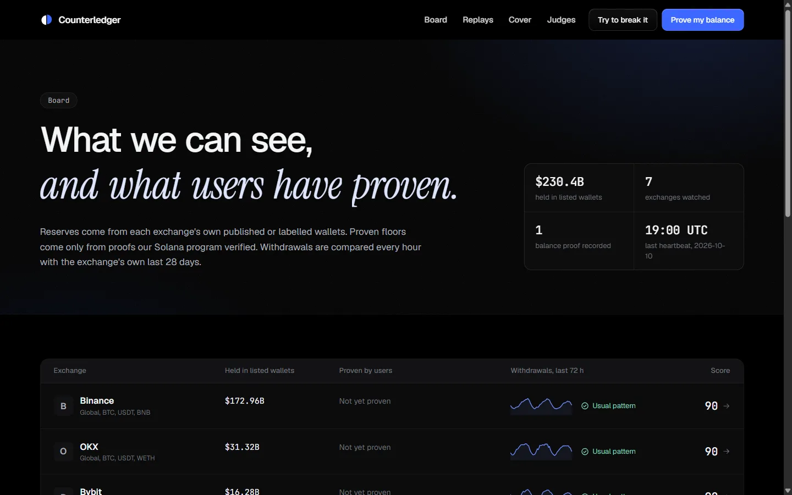
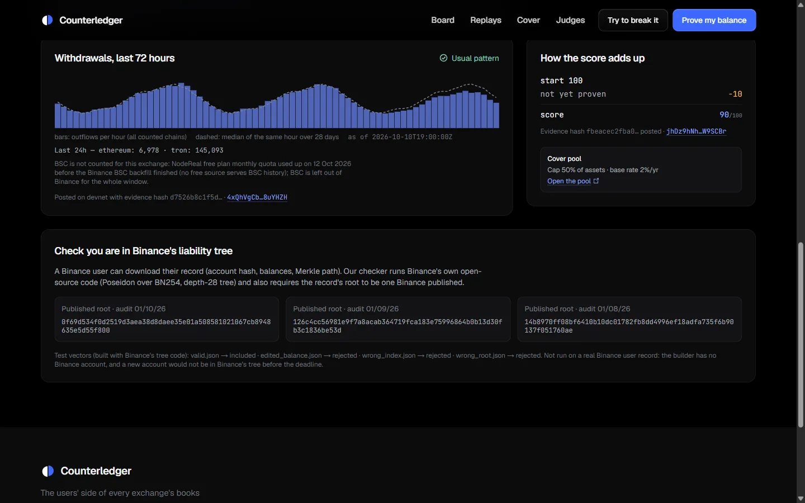
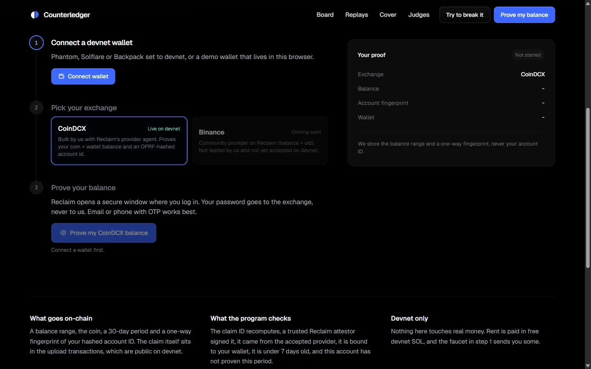
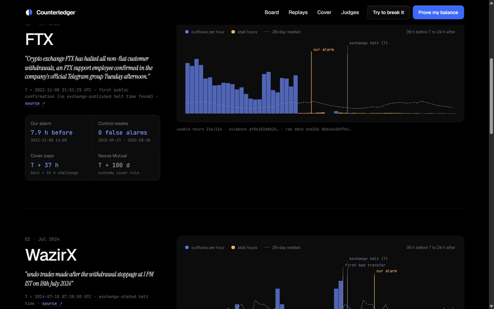
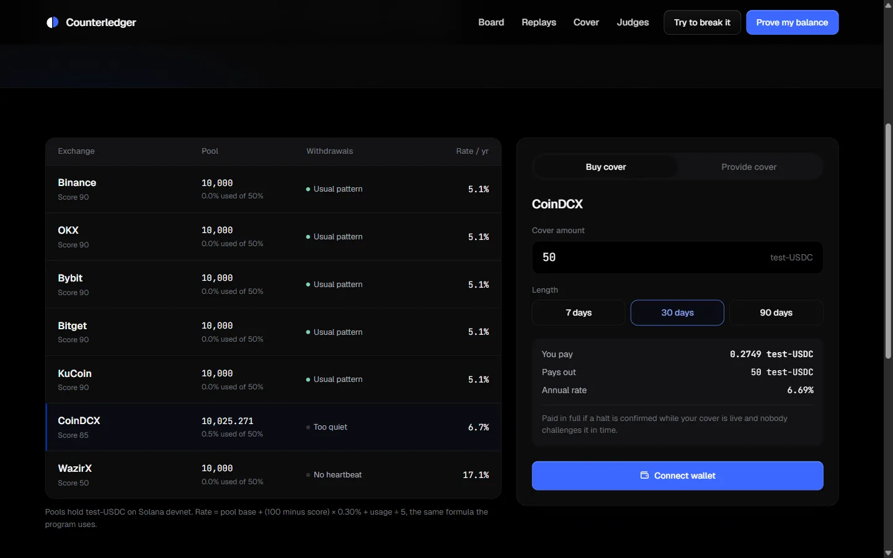
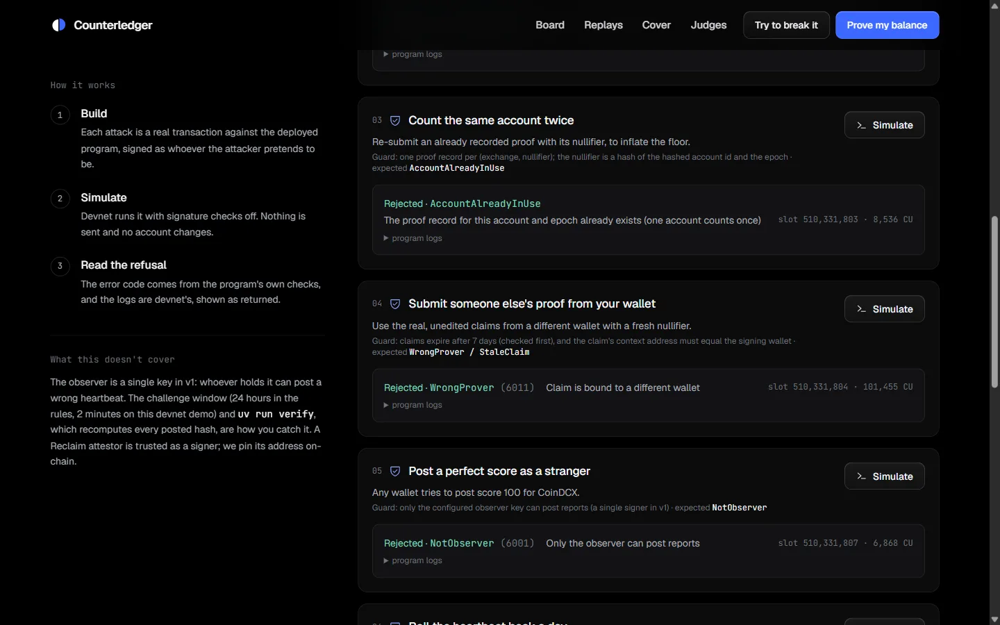

<div align="center">


# Counterledger

**Your exchange shows you a balance. Now you can check it.**

The users' side of every exchange's books, on Solana. Users prove the balance their exchange shows them with zkTLS,
a public watcher reads each exchange's own wallets every hour, and a cover market is priced by what is proven and
paid by proof when withdrawals stop.

[**Live app**](https://counterledger-mauve.vercel.app) ·
[**Watch the demo**](https://youtu.be/jozuFSEmUv0) ·
[**Check it yourself**](https://counterledger-mauve.vercel.app/judges) ·
[**Try to break it**](https://counterledger-mauve.vercel.app/break) ·
[Build log](hackathon.md) ·
[How it works](#how-it-works) ·
[Running it](#running-it)

[](https://github.com/rohit-jsfreaky/counterledger/actions/workflows/ci.yml)


</div>

> **Devnet only, test-USDC only.** The cover market is a protocol demo, not insurance.

---

## The problem, in numbers

On **8 November 2022**, FTX customers could open the app and see their balances, right up until withdrawals
stopped. The first public confirmation came from a support employee in a Telegram group, at **21:51 UTC**.[^ftx]

Exchanges now publish proof of reserves: what they **hold**. What they **owe** each user is still their own word, kept on
their own servers. When withdrawals stop, the people who are owed the money find out last.

The market tried to insure exactly this and could not price it. Nexus Mutual sold **$220M** of Custody Cover, paid
**$6,065,241.96** in claims, and then proposed retiring the product because:

> "any given custodian's off chain liabilities are not known and the proof of reserve audits have come into question"[^nexus-rfc]

A claim on that cover could only start after withdrawals had been halted for **100 days** (90 for the FTX-era
claims).[^nexus-product][^nexus-ftx]

### Why users find out last

| What you would need to know | Where it is today |
|---|---|
| What the exchange holds | Published, in wallets anyone can read |
| What the exchange owes you | Only on its own servers. You see one number, yours, and cannot prove it to anyone |
| Whether withdrawals are slowing | Public on-chain, hour by hour, and nobody is watching it for you |
| Whether you can get cover | Gone. The data it needed did not exist |

None of the missing pieces is secret. They are just held by the one party with no reason to show them. **Counterledger
builds them from the users' side.**

---

## What it does

Three parts, one ledger on Solana.

### The board: what we can see, and what users have proven

Every exchange on one page: the reserves in its own published wallets, the withdrawals of the last 72 hours against its
usual pattern, the floor its users have proven, and a score. Each number links to its source.

<div align="center">

</div>

**$230.4B** across six exchanges, from wallets they published themselves, every address with a source. WazirX shows
"—", with the reason: it has no current published address list.

### One exchange, every input shown

Open an exchange and the score comes apart into its inputs: sourced reserves, the withdrawal heartbeat, proofs. The
same page lets a Binance user check their own record is a leaf of the liability tree Binance published, with Binance's
own open-source verifier.

<div align="center">

</div>

### Prove the balance your exchange shows you

One login, one signed fact. Reclaim's zkTLS proves the coin and balance came from the exchange's own server, and that
the account belongs to someone, without us ever seeing the login, the account id or the exact amount. Our Solana
program checks the attestor's signature itself and adds the balance to that exchange's **floor**, once per account per
30 days.

<div align="center">

</div>

A floor is a floor: **proven by N accounts, a minimum, never the total.** One real proof is on devnet so far, from a
real CoinDCX account (tx `4ycyayVfCm3h…`).

### Watching every withdrawal, tested on three real halts

Every hour the watcher counts transfers out of each exchange's wallets on Ethereum, Tron and BSC, against the same hour
over the previous 28 days. Three hours in a row under a quarter of the usual level, and the heartbeat reads "below its
usual pattern". The rules were written down before any backtest data was fetched.

<div align="center">

</div>

| Event | Transfers read | Halt time T | Our alarm | Normal weeks | False alarms |
|---|---|---|---|---|---|
| FTX, Nov 2022 | 815,100 | Nov 8 21:51 UTC, first public report[^ftx] | **7.9 h before T** | 2 | 0 |
| WazirX, Jul 2024 | 8,431 | Jul 18 07:30 UTC, exchange-stated[^wazirx] | 6.5 h after T | 2 | **1** |
| Bitget, Sep 2026 | 414,148 | Sep 24 19:05 UTC, exchange-stated[^bitget] | 5.9 h after T | 2 | 0 |

FTX was a run, and its withdrawals collapsed before the halt was public. WazirX and Bitget were sudden incidents
announced quickly: the heartbeat confirmed them within hours, it did not predict them. We publish both, and the false
alarm.

### Cover, paid by proof

One pool per exchange, in test-USDC. The price rises as the score falls and the pool fills. A confirmed halt (24 hours
under a tenth of the usual daily volume) opens a challenge window; if nobody challenges it, every live cover on that
exchange pays in full. No vote, no claims desk.

<div align="center">

</div>

| Event | Counterledger pays | Nexus Custody Cover | False payouts in normal weeks |
|---|---|---|---|
| FTX | **T + 37 h** | T + 100 days | 0 |
| WazirX | T + 48 h | same | 0 |
| Bitget | T + 47 h | same | 0 |

The FTX halt is replayed end to end on devnet: cover bought, halt posted, 1,000 test-USDC paid
([transactions](evidence/onchain/replay-ftx-2022-11-a1.json)).

---

## Don't take our word for it

Every claim on the site is checkable, and the site lets you check it.

**Recompute every number.** `uv run verify` rebuilds every published figure from committed inputs, with no keys and no
network, and checks that the hashes posted on devnet match. It ends with `32/32 PASS`. CI runs it on every push.

**Try to break it.** `/break` builds seven attacks as real transactions against the deployed program and asks devnet
to simulate them, so every refusal comes from the program's own checks. An honest control report runs first and is
accepted, so you know the simulator is not just rejecting everything.

<div align="center">

</div>

| The attack | Refused with |
|---|---|
| Edit a real proof to claim 250,000 USDT | `UntrustedAttestor` |
| Count the same account twice | `AccountAlreadyInUse` |
| Submit someone else's proof from your wallet | `WrongProver` |
| Post a perfect score as a stranger | `NotObserver` |
| Roll the heartbeat back a day | `StaleReport` |
| Buy more cover than the pool can pay | `ExposureCap` |
| Buy cover after the halt is known | `HaltSignalActive` |

**Check your own Binance account.** The inclusion checker runs Binance's own zkMerkle code (Poseidon over BN254,
depth-28 tree) on a record you download from Binance, against the root Binance published.

---

## How it works

```
  exchange wallets (Ethereum · Tron · BSC)            a user's exchange login
            │                                                  │
            ▼                                                  ▼
  watcher, every hour ──► heartbeat + score         Reclaim zkTLS ──► two signed claims
  (vs. the last 28 days)    + evidence JSON          (balance, OPRF-hashed account id)
            │                     │                            │
            │      sha256 posted with every report             │ uploaded in chunks
            ▼                     ▼                            ▼
  ┌──────────────────────── Anchor program on Solana devnet ────────────────────────┐
  │  post_heartbeat · post_score          record_proof: recompute claim ids,       │
  │                                       recover the attestor (secp256k1+keccak), │
  │                                       wallet = context, < 7 days, one per      │
  │                                       account per epoch ──► the floor          │
  │                                                                                 │
  │  pool per exchange ── buy_cover (priced by score + usage, capped at 50%)        │
  │  confirmed halt ──► challenge window ──► finalize ──► every live cover pays     │
  └─────────────────────────────────────────────────────────────────────────────────┘
            ▲
  uv run verify: recomputes every report from committed data and checks the posted hashes
```

Program `5DCUGtXcR4DcBi7FpyRv1fGtUS3zTHJy9kXoDH8yxG9K` on devnet.

| Account | Seeds | Holds |
|---|---|---|
| `Config` | `config` | admin, observer, trusted Reclaim attestors, challenge window |
| `Exchange` | `exchange, id` | accepted provider hashes, proven floors per asset, prover count, latest heartbeat and score with evidence hashes |
| `ClaimBuffer` | `claims, prover` | the Reclaim claim bytes, uploaded in chunks (a claim is larger than one transaction) |
| `ProofRecord` | `proof, exchange, nullifier` | balance bucket, asset, epoch, claim ids. Its existence is the "counted once" guard |
| `Pool` / `LpPosition` / `Cover` | `pool, exchange` / `lp, pool, owner` / `cover, pool, index` | test-USDC vault, exposure cap, trigger state, positions |

**The score** = 100 minus: no sourced reserves (25), withdrawals too quiet to compare (15) or below their usual pattern
(30), a proven shortfall in any coin (40), no proofs yet (10). It shows how much can be seen and proven from outside. It
is not a solvency rating.

---

## Built on

### Solana: the ledger, and the referee

The program is where a proof stops being our claim and becomes something anyone can check.

| What | Where |
|---|---|
| **zkTLS verified on-chain.** Recomputes each Reclaim claim id (`keccak(provider \n parameters \n context)`) and recovers the attestor from its signature, with Solana's secp256k1 recover. No off-chain verifier in the trust path. | `program/programs/counterledger/src/claim.rs`, `instructions/record_proof.rs` |
| **Counted once.** The nullifier `keccak("counterledger:v1:" + exchange + ":" + account_id + ":" + epoch)` is a PDA seed, so the same account cannot raise a floor twice in 30 days. | `instructions/record_proof.rs` |
| **Claim buffers.** A two-claim proof is larger than the 1,232-byte transaction limit, so it is uploaded in chunks and checked in one call. | `instructions/buffer.rs` |
| **Reports with receipts.** Every heartbeat and score carries the sha256 of its evidence file. | `instructions/reports.rs` |
| **A cover market.** Per-exchange pools, LP positions, an exposure cap, a halt signal that blocks new cover, a challenge window and payouts. | `instructions/cover.rs` |

15 tests (LiteSVM). The IDL is committed in `program/idl/`.

### Reclaim Protocol: the only source of the liability side

Remove it and the floor column is empty: without the exchange's cooperation, there is no other way to learn what it
owes a user.

- **Provider:** CoinDCX, `2d2421ec-43bf-4ab4-a1b9-2eb13cc963e6`, built with Reclaim's provider agent. It reads
  `wallet_balance` and `asset` from the portfolio call and `account_id` from `api/v1/user_details`, hashed by Reclaim's
  OPRF so we never see it.
- **Session:** `web/src/app/api/reclaim/session/route.ts` builds the request server-side, so the app secret never reaches
  the browser, and binds it to the user's wallet (`contextAddress`) and the current 30-day epoch.
- **Trusted attestor:** `0x244897572368eadf65bfbc5aec98d8e5443a9072`, pinned on-chain.

Things learned the hard way:

- CoinDCX's `user_details` call carries a `cb` parameter equal to its timestamp header, which breaks matching. The
  provider fires its own clean in-page fetch instead.
- Reclaim's devnet verifier program `rEcLDW…` had no recent activity and the newer example uses a different account
  layout, so we verify the attestor signature in our own program. The check is fully on-chain and fixed to one key.
- Binance has a community balance provider on Reclaim. We have not tested it and the program does not accept it, so the
  site marks it "coming soon".

### The data underneath

| Source | What it gives | Where |
|---|---|---|
| Etherscan (V2) | hourly outflows from exchange wallets on Ethereum | `engine/src/counterledger/etherscan.py` |
| TronGrid | the same on Tron | `engine/src/counterledger/tron.py` |
| NodeReal | the same on BSC | `engine/src/counterledger/bsc.py` |
| DefiLlama | per-asset reserve balances and address lists | `engine/src/counterledger/reserves.py` |
| Helius | devnet RPC for the site | `web/src/lib/devnet-rpc.ts` |
| Binance zkmerkle-proof-of-solvency | the inclusion check, Binance's own code | `tools/inclusion/` |

**Record once, replay free.** Every external call goes through a cache keyed by the request hash, with secrets scrubbed
and errors never cached. That is why `verify` needs no keys and no network, and why a crashed 29-day backfill resumes
exactly where it stopped.

A few things that only showed up by building it:

- **Etherscan returns at most 1,000 rows.** The pager walks block ranges until no new rows appear, and reads any block
  that alone holds 1,000 or more page by page.
- **Helius devnet sometimes answers "account not found" for accounts that exist** (about 1 read in 4 on 11 Oct). The
  site's RPC proxy retries empty reads, then asks the public devnet RPC.
- **Free tiers have edges.** On a rate limit the cache slows that host down and waits instead of failing; a monthly quota
  fails fast and says so.

---

## Running it

```bash
git clone https://github.com/rohit-jsfreaky/counterledger && cd counterledger/engine
uv run verify            # recomputes every published number from committed data (needs uv + Go): 32/32 PASS
uv run pytest            # 16 tests
cd ../program && cargo build-sbf --manifest-path programs/counterledger/Cargo.toml && cargo test   # 15 tests
cd ../web && npm install && npm run dev                                                             # the site
```

| Folder | What | Stack |
|---|---|---|
| `engine/` | watcher, reserves, backtests, score, `verify` | Python 3.12, uv, httpx, pydantic, pytest |
| `program/` | the Anchor program and its tests | Rust, Anchor 1.1, solana-cli 3.1.10, LiteSVM |
| `web/` | the site, RPC proxy, Reclaim session, faucet, attack simulator | Next.js 16, Tailwind 4, wallet adapter, Reclaim JS SDK |
| `tools/` | `prove/` (record a proof), `devnet/` (setup, reports, pools, replay, break), `inclusion/` (Go) | Node, Go |
| `data/`, `evidence/` | committed inputs and every published result | JSON, CSV |

The live proof flow needs `HELIUS_API_KEY`, `RECLAIM_APP_ID` and `RECLAIM_APP_SECRET` in `.env`; everything else works
without keys. The full transfer lists behind the backtests are release assets
([data-v1](https://github.com/rohit-jsfreaky/counterledger/releases/tag/data-v1)); CI downloads them. A live heartbeat
whose backfill is still running prints PENDING, never a pass.

---

## Where it goes next

Honest about today, and each of these is the natural next build rather than a hole.

**More provers, more exchanges.** One real proof is on devnet so far, from CoinDCX. The provider reads the first coin in
the portfolio only (v1). Binance's community provider, more coins per proof, and providers for the Indian exchanges
with no public reserve tracker (WazirX, ZebPay, CoinSwitch, Mudrex) are next.

**More than one watcher.** The observer is a single signer in v1. Every report carries its evidence hash, `verify`
recomputes it, and the challenge window is the guard against a wrong one. Several independent observers signing the
same report is the obvious extension.

**Stuck-withdrawal proofs.** The rules call for three users proving a withdrawal that never arrived before a payout. That
proof type is not built, so devnet payouts use the on-chain halt rule and the challenge window alone.

**Every chain an exchange uses.** Binance's live heartbeat leaves out BSC: NodeReal's free monthly quota ran out before
its 33 BSC wallets were read, and no free source serves BSC history. It is left out of the whole 29-day window, and the
reason is written in `evidence/heartbeat/binance.json`. The backtests use Ethereum only.

**Real users on the inclusion check.** It is verified with Binance's own code on test vectors built with Binance's tree
code, not yet on a real Binance user record. Binance's own bundled sample fails Binance's own verifier at the pinned
commit, so it is not used.

**What is real, what is demo.** Real: exchange addresses and balances with their sources, on-chain flows, the three
historical events and their sources, the CoinDCX proof from a real account, every devnet transaction. Demo: test-USDC
pools, LP and cover positions, the built-in demo wallet, and the 120-second challenge window on devnet (24 hours in the
rules).

**This is not a solvency rating and not insurance**, and it never says an exchange is either. It shows what can be seen
and proven from outside, with the formula and its inputs.

---

<div align="center">

Built solo during the Colosseum hackathon (14 Sep – 12 Oct 2026), for the Colosseum Crypto World's Fair and Superteam
India.

Solana · Reclaim Protocol · Etherscan · TronGrid · NodeReal · DefiLlama · Helius

</div>

<sub>Powered by Etherscan.io APIs. My earlier project Cairn (browser agents that repair themselves when sites change)
shaped how I think about zkTLS providers breaking when exchanges change their pages; no Cairn code is reused here. Built
with help from Claude (AI pair programmer); commits carry a co-author line.</sub>

[^nexus-rfc]: Nexus Mutual forum, "[RFC]: Deprecate Custody Cover product", 22 May 2023, https://forum.nexusmutual.io/t/rfc-deprecate-custody-cover-product/1093
[^nexus-product]: Nexus Mutual, Custody Cover product page ("halted (for 100 days or longer)"), https://nexusmutual.io/product-index/custody-cover
[^nexus-ftx]: Nexus Mutual docs, FTX claims history (claims after the 90-day period), https://docs.nexusmutual.io/overview/claims-history/ftx
[^ftx]: CoinDesk, 8 Nov 2022, https://www.coindesk.com/business/2022/11/08/ftx-exchange-halts-all-crypto-withdrawals
[^wazirx]: WazirX, day-wise report, https://wazirx.com/blog/wazirx-cyber-attack-day-wise-report/
[^bitget]: Bitget Academy, incident timeline, https://www.bitget.com/academy/bitget-security-incident-what-happened-timeline-impact-response
