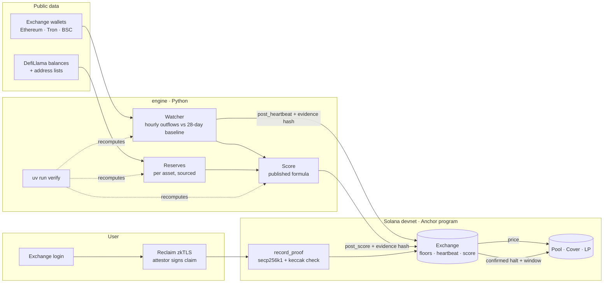

# Counterledger

**The users' side of every exchange's books, on Solana.** Users prove the balance their exchange shows them with zkTLS,
a public watcher reads each exchange's own wallets every hour, and a cover market on Solana is priced by what is proven
and paid by a confirmed withdrawal halt.

[Judge it in 90 seconds](#judge-it-in-90-seconds) · [The numbers](#the-numbers) · [How Reclaim decides](#how-reclaim-zktls-decides) · [Limits](#honesty-limits-and-whats-real)

[](https://github.com/rohit-jsfreaky/counterledger/actions/workflows/ci.yml)


**Live site: https://counterledger-mauve.vercel.app** · judges start at [/judges](https://counterledger-mauve.vercel.app/judges)

<!-- TODO(Rohit): demo video link here once published -->

> Exchanges publish what they hold. Counterledger lets their users prove what they are owed, watches every withdrawal,
> and pays out if they stop. **Devnet only, test-USDC only. The cover market is a protocol demo, not insurance.**

---

## Judge it in 90 seconds

**Open the site** (live URL above), or run everything locally with no keys and no network:

```bash
git clone https://github.com/rohit-jsfreaky/counterledger && cd counterledger/engine
uv run verify            # recomputes every published number from committed data (needs uv + Go)
uv run pytest            # 16 tests
cd ../program && cargo build-sbf --manifest-path programs/counterledger/Cargo.toml && cargo test   # 15 tests
cd ../web && npm install && npm run dev                                                             # the site
```

**Four before → after numbers** (FTX, November 2022, rules fixed before the first run):

| | Without Counterledger | With Counterledger |
|---|---|---|
| When users learn withdrawals stopped | First public report, Nov 8 21:51 UTC | Our alarm, Nov 8 14:00 UTC: **7.9 h earlier** |
| When cover pays | A claim can start after a 100-day halt (Nexus Mutual Custody Cover)[^nexus-product] | **37 h** after the public report |
| What users can check about what the exchange owes | Its own word | A floor proven by users, verified on Solana |
| Normal weeks flagged by mistake | n/a | **1 false alarm, 0 false payouts** in 6 normal weeks |

**Which page to open:** `/judges` (the 60-second path) → `/board` → `/break` (run the attacks yourself) → `/cover`
(connect the built-in demo wallet, get test-USDC from the faucet, buy cover).

## Contents

1. [The problem](#the-problem)
2. [What I built](#what-i-built)
3. [Architecture and data model](#architecture-and-data-model)
4. [The core loop](#the-core-loop)
5. [How Reclaim zkTLS decides](#how-reclaim-zktls-decides)
6. [Engineering decisions and hard problems](#engineering-decisions-and-hard-problems)
7. [The numbers](#the-numbers)
8. [Honesty: limits and what's real](#honesty-limits-and-whats-real)
9. [Stack, layout, running it, attribution](#stack-layout-running-it-attribution)

## The problem

Exchanges publish proof of reserves: what they **hold**. What they **owe** their users is their own word, and when
withdrawals stop, users find out last.

The market tried to insure this and failed for exactly that reason. Nexus Mutual sold **$220M** of Custody Cover and
paid **$6,065,241.96** in claims, then proposed retiring it because "any given custodian's off chain liabilities are not
known and the proof of reserve audits have come into question".[^nexus-rfc] A claim needed withdrawals halted for 100 days
(90 days for the FTX-era claims).[^nexus-product][^nexus-ftx]

The data that cover needed did not exist. Counterledger builds it from the users' side.

## What I built

1. **A withdrawal watcher** (`engine/`). For 7 exchanges it reads the exchange's own published or labelled wallets on
   Ethereum, Tron and BSC and counts outgoing transfers every hour, comparing each hour with the same hour over the
   previous 28 days. It also sums reserves from the same wallets, every number with an address source and a balance
   source.
2. **Backtests on three real halts** (FTX Nov 2022, WazirX Jul 2024, Bitget Sep 2026) with parameters pre-registered in
   `data/heartbeat-params.json` and `data/cover-params.json` before any data was fetched, plus two normal weeks per
   exchange as controls.
3. **zkTLS balance proofs** (`tools/prove/`, `web/src/app/prove`). A Reclaim provider for CoinDCX, built with Reclaim's
   provider agent, proves the user's coin and balance plus an OPRF-hashed account id. One real proof from a real CoinDCX
   account is recorded on devnet.
4. **An Anchor program on Solana devnet** (`program/`). It verifies the Reclaim attestor's signature itself
   (secp256k1 recover + keccak), adds the balance to the exchange's proven floor once per account per 30 days, records
   the watcher's heartbeat and score with their evidence hashes, and runs per-exchange cover pools with an exposure cap,
   a challenge window and payouts.
5. **A Binance inclusion checker** (`tools/inclusion`). Runs Binance's own open-source zkMerkle code (Poseidon over
   BN254, depth-28 tree) to check a user's record is a leaf of the liability tree Binance published.
6. **A website** (`web/`): landing, board, exchange pages, prove, cover, replay, judges, and "Try to break it", which
   simulates 7 attacks against the deployed program. A built-in demo wallet means nobody needs to install anything.
7. **`uv run verify`**, which recomputes every published number from committed inputs and checks the hashes posted on
   devnet. CI runs it on every push, with the program's tests and the web build.

## Architecture and data model



Program `5DCUGtXcR4DcBi7FpyRv1fGtUS3zTHJy9kXoDH8yxG9K` on devnet. Accounts:

| Account | Seeds | Holds |
|---|---|---|
| `Config` | `config` | admin, observer, trusted Reclaim attestors, challenge window |
| `Exchange` | `exchange, id` | accepted provider hashes, proven floors per asset, prover count, latest heartbeat and score (value, as-of, evidence hash) |
| `ClaimBuffer` | `claims, prover` | the Reclaim claim bytes, uploaded in chunks (a claim is larger than one transaction) |
| `ProofRecord` | `proof, exchange, nullifier` | balance bucket, asset, epoch, claim ids. Its existence is the "counted once" guard |
| `Pool` / `LpPosition` / `Cover` | `pool, exchange` / `lp, pool, owner` / `cover, pool, index` | test-USDC vault, exposure cap, trigger state, positions |

## The core loop

1. **Prove.** The user connects a wallet and starts a Reclaim session bound to it (`contextAddress` = the wallet). They
   log in to CoinDCX in Reclaim's window; Reclaim returns two signed claims: the account id (OPRF-hashed) and the coin +
   balance.
2. **Verify on Solana.** The browser uploads the claim bytes to a `ClaimBuffer`, then calls `record_proof`. The program
   recomputes each claim id (`keccak(provider \n parameters \n canonical context)`), recovers the attestor from the
   signature over `0x<id>\n<owner>\n<timestamp>\n<epoch>`, and requires: a trusted attestor, an accepted provider hash,
   `contextAddress` equal to the signer, a claim under 7 days old, and both claims from the same epoch. The nullifier
   `keccak("counterledger:v1:" + exchange + ":" + account_id + ":" + epoch)` is a PDA seed, so the same account cannot
   be counted twice in a 30-day epoch. The balance is added to the floor; only a bucket is stored.
3. **Watch.** Every hour the watcher counts outflows from each exchange's wallets. If three straight hours fall under a
   quarter of the usual level, the heartbeat is "below its usual pattern". The state and the sha256 of its evidence JSON
   are posted with `post_heartbeat`; the score with `post_score`.
4. **Cover.** `buy_cover` prices a cover from the score and pool usage (annual rate = base + (100 − score) × 0.30% +
   usage ÷ 5) and refuses it above 50% of pool assets or while a halt signal is active.
5. **Pay.** A confirmed halt (24 hours under a tenth of the usual daily volume) opens a trigger; after an unchallenged
   challenge window (24 h in the rules, 120 s on the devnet demo) it is finalized and every live cover on that exchange
   claims its full amount. The FTX halt is replayed end to end on devnet: cover bought, halt posted, paid 1,000
   test-USDC ([transactions](evidence/onchain/replay-ftx-2022-11-a1.json)).

## How Reclaim zkTLS decides

Reclaim is the only source of the liability side. Remove it and the floor column is empty: there is no other way to
learn what an exchange owes a user without the exchange's cooperation.

- **Provider:** CoinDCX, `2d2421ec-43bf-4ab4-a1b9-2eb13cc963e6`, built with Reclaim's provider agent (the DevTool is being
  deprecated). It reads `wallet_balance` and `asset` from the portfolio call and `account_id` from `api/v1/user_details`,
  with the account id hashed by Reclaim's OPRF so we never see it.
- **Session:** `web/src/app/api/reclaim/session/route.ts` builds the request server-side (the app secret never reaches the
  browser) and sets the context to `{ app, exchange, epoch }` with the user's wallet as `contextAddress`.
- **On-chain check:** `program/programs/counterledger/src/claim.rs` and `instructions/record_proof.rs`. Trusted attestor:
  `0x244897572368eadf65bfbc5aec98d8e5443a9072`.

**Things learned the hard way**

- CoinDCX's `user_details` call carries a `cb` parameter equal to its timestamp header, which breaks matching; the
  provider fires its own clean in-page fetch instead.
- Reclaim's devnet verifier program `rEcLDW…` had only epoch-config transactions, the latest in Oct 2024, and the newer
  example program uses a different account layout. We verify the attestor signature in our own program instead, so the
  check is fully on-chain and fixed to one attestor key.
- A two-claim proof is larger than Solana's 1,232-byte transaction limit, so claims are uploaded to a buffer account in
  chunks and checked in one `record_proof` call.
- Binance has a community balance provider on Reclaim; it is not tested by us and not accepted on devnet, so the site
  marks it "coming soon".

## Engineering decisions and hard problems

- **Record once, replay free.** Every external call (Etherscan, TronGrid, NodeReal, DefiLlama, Reclaim) goes through a
  cache keyed by the request hash, with secrets scrubbed and errors never cached. `verify` runs in replay mode with no
  keys and no network.
- **Pre-registration.** Heartbeat and cover rules were written to `data/*-params.json` with a `fixed_at` time before any
  backtest data was fetched. A parameter sweep is published as a control, not used to pick the best number.
- **Etherscan's 1,000-row cap.** The pager walks block ranges until no new rows appear and reads any block that alone
  holds ≥ 1,000 rows page by page.
- **Free-tier limits.** BSC history comes from NodeReal (span limits per network); Tron from TronGrid. On a rate limit
  the cache slows that host down and waits instead of failing; a monthly quota fails fast. The long backfills pin their
  end hour and run under a supervisor that restarts them, so a crash resumes exactly where it stopped, from the cache.
- **Helius devnet sometimes answers "account not found" for accounts that exist** (about 1 read in 4 on 11 Oct). The site's
  RPC proxy retries empty reads, then asks the public devnet RPC.
- **Attacks are real transactions.** `/break` builds each attack against the deployed program and runs
  `simulateTransaction` with signature checks off, so the rejection comes from the program's own checks. Two throwaway
  wallets hold claim buffers on devnet for the forged-proof and replayed-proof attacks (`tools/devnet/break-setup.mjs`).

## The numbers

All from `evidence/`, recomputed by `uv run verify`.

**Withdrawal heartbeat** (K = 0.25 of the usual hourly level, N = 3 hours, 28-day baseline)

| Event | Transfers read | Halt time T (source) | Our alarm | Control weeks | False alarms |
|---|---|---|---|---|---|
| FTX, Nov 2022 | 815,100 | Nov 8 21:51 UTC, first public report[^ftx] | **7.9 h before T** | 2 | 0 |
| WazirX, Jul 2024 | 8,431 | Jul 18 07:30 UTC, exchange-stated[^wazirx] | 6.5 h after T | 2 | **1** |
| Bitget, Sep 2026 | 414,148 | Sep 24 19:05 UTC, exchange-stated[^bitget] | 5.9 h after T | 2 | 0 |

WazirX and Bitget were sudden incidents announced quickly; the heartbeat confirmed them within hours, it did not
predict them. FTX was a run, and its withdrawals collapsed before the halt was public.

**Cover payout** (24 h under a tenth of the usual daily volume, then a 24 h challenge window)

| Event | Pays | Nexus Custody Cover | False payouts in controls |
|---|---|---|---|
| FTX | T + 37 h | T + 100 days (90 for FTX-era claims) | 0 |
| WazirX | T + 48 h | same | 0 |
| Bitget | T + 47 h | same | 0 |

**Live, as of the last run** (reserves read 10 Oct 2026)

| Exchange | Reserves in listed wallets | Withdrawals | Proven by users | Score |
|---|---|---|---|---|
| Binance | $172.96B | usual pattern (Ethereum + Tron; BSC left out, see limits) | not yet proven | 90 |
| OKX | $31.32B | usual pattern | not yet proven | 90 |
| Bybit | $16.28B | usual pattern | not yet proven | 90 |
| Bitget | $6.21B | usual pattern | not yet proven | 90 |
| KuCoin | $3.45B | usual pattern | not yet proven | 90 |
| CoinDCX | $184.1M | too quiet to compare | 0.998993 USDT, 1 account (a minimum) | 85 |
| WazirX | — (no current published address list) | — | not yet proven | 50 |

Score = 100 minus: no sourced reserves (25), withdrawals too quiet to compare (15) or below their usual pattern (30), a
proven shortfall in any coin (40), no proofs yet (10). It shows how much can be seen and proven from outside; it is not a
solvency rating.

**Attacks** (`/break`, simulated against the deployed program): edited proof → `UntrustedAttestor`; same account twice →
`AccountAlreadyInUse`; someone else's proof → `WrongProver`; stranger posts a score → `NotObserver`; heartbeat rolled
back → `StaleReport`; cover above the cap → `ExposureCap`; cover after a halt → `HaltSignalActive`. An honest control
report is accepted.

## Honesty: limits and what's real

- **A floor is a floor.** Proven amounts count only people who chose to prove. It is a minimum, never the total.
- **One real proof so far** (CoinDCX, < 1 USDT). The provider proves the first coin in the portfolio only (v1), and its
  OPRF mode is server-side (`oprf-raw`).
- **The watcher is a single signer in v1.** Every report carries its evidence hash and `verify` recomputes it; the
  challenge window is the guard against a wrong report. Multiple observers are future work.
- **The cover market is a protocol demo, not insurance**, on devnet with test-USDC. The rules also call for k = 3
  stuck-withdrawal proofs before a payout; that proof type is not built, so devnet payouts use the heartbeat rule and the
  challenge window alone.
- **Inclusion check:** verified with Binance's own code on test vectors built with Binance's tree code; it has not been
  run on a real Binance user record (I have no Binance account). Binance's bundled sample record fails Binance's own
  verifier at the pinned commit, so it is not used.
- **Binance's live heartbeat leaves out BSC.** NodeReal's free monthly quota ran out on 12 Oct before Binance's 33 BSC
  wallets were read, and no free source serves BSC history (public RPCs refuse it; BscScan's API is paid). BSC is left
  out for the whole 29-day window, never part of it, and the reason is in `evidence/heartbeat/binance.json`.
- **Backtests use Ethereum only** for the hourly signal (Tron and BSC are added for the live watcher). The WazirX
  backtest has thin data (8,431 transfers), and one normal WazirX week raised a false alarm.
- **Real:** exchange addresses and balances (with sources), on-chain flows, the three historical events and their
  sources, the CoinDCX proof from a real account, every devnet transaction. **Demo:** test-USDC pools, LP and cover
  positions, the demo wallet, and the 120 s challenge window on devnet.
- **Built during the hackathon** (Sep 14 to Oct 12, 2026), solo. My earlier project Cairn (browser agents that repair
  themselves when sites change) shaped how I think about zkTLS providers breaking when exchanges change their pages; no
  Cairn code is reused here.

## Stack, layout, running it, attribution

| Folder | What | Stack |
|---|---|---|
| `engine/` | watcher, reserves, backtests, score, `verify` | Python 3.12, uv, httpx, pydantic, pytest |
| `program/` | Anchor program + LiteSVM tests (`idl/` holds the committed IDL) | Rust, Anchor 1.1, solana-cli 3.1.10 |
| `web/` | the site, RPC proxy, Reclaim session, faucet, attack simulator | Next.js 16, Tailwind 4, wallet adapter, Reclaim JS SDK |
| `tools/` | `prove/` (record a proof), `devnet/` (setup, reports, pools, replay, break), `inclusion/` (Go) | Node, Go |
| `data/`, `evidence/` | committed inputs and every published result | JSON, CSV |

**Run it:** see [Judge it in 90 seconds](#judge-it-in-90-seconds). `uv run verify` ends with a line like
`32/32 PASS`. A live heartbeat whose 29-day backfill is still running prints PENDING, never counted as a pass.
The site needs `HELIUS_API_KEY`, `RECLAIM_APP_ID` and `RECLAIM_APP_SECRET` in `.env` for the live proof flow; everything
else works without keys. The full transfer lists for the backtests are release assets
([data-v1](https://github.com/rohit-jsfreaky/counterledger/releases/tag/data-v1)); CI downloads them.

**Attribution.** Powered by Etherscan.io APIs. Also TronGrid, NodeReal, DefiLlama (balances and address lists), Helius
(devnet RPC), Reclaim Protocol (zkTLS), Binance zkmerkle-proof-of-solvency (inclusion check). Built with help from Claude
(AI pair programmer); commits carry a co-author line.

[^nexus-rfc]: Nexus Mutual forum, "[RFC]: Deprecate Custody Cover product", 22 May 2023, https://forum.nexusmutual.io/t/rfc-deprecate-custody-cover-product/1093
[^nexus-product]: Nexus Mutual, Custody Cover product page ("halted (for 100 days or longer)"), https://nexusmutual.io/product-index/custody-cover
[^nexus-ftx]: Nexus Mutual docs, FTX claims history (claims after the 90-day period), https://docs.nexusmutual.io/overview/claims-history/ftx
[^ftx]: CoinDesk, 8 Nov 2022, https://www.coindesk.com/business/2022/11/08/ftx-exchange-halts-all-crypto-withdrawals
[^wazirx]: WazirX, day-wise report, https://wazirx.com/blog/wazirx-cyber-attack-day-wise-report/
[^bitget]: Bitget Academy, incident timeline, https://www.bitget.com/academy/bitget-security-incident-what-happened-timeline-impact-response
